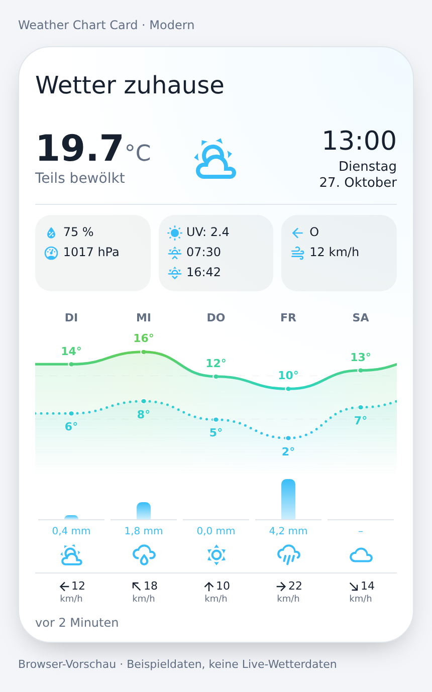
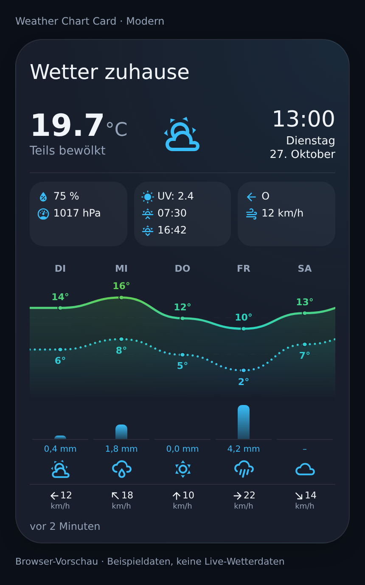
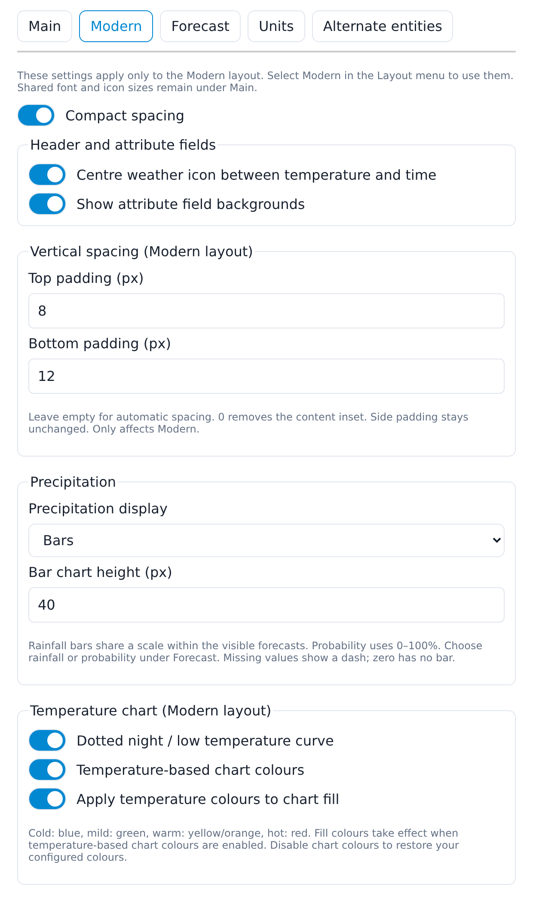
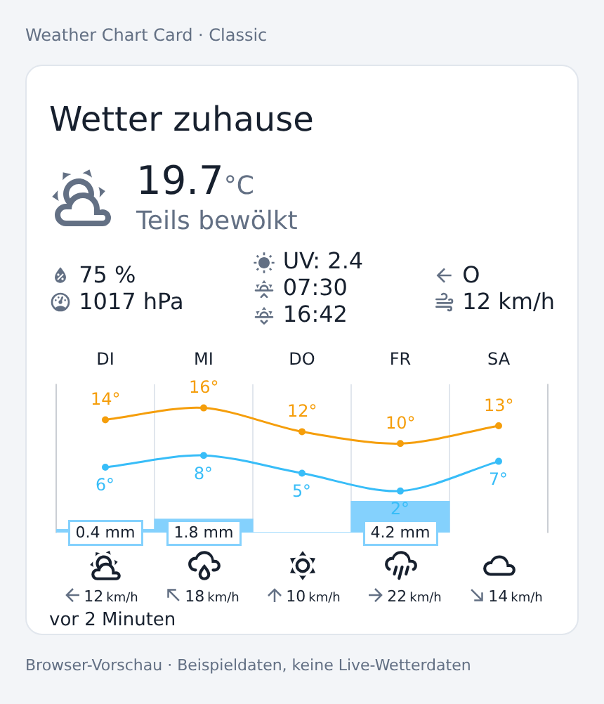

# Weather Chart Card

A custom Home Assistant **Lovelace dashboard card** with current weather, daily or
hourly forecasts, temperature curves and precipitation. This fork maintains the
original Classic layout and adds an optional, responsive **Modern** layout.
This is a frontend card, not a Home Assistant add-on or weather-data integration.

[](https://github.com/cercytrone/weather-chart-card/releases/latest)
[](LICENSE.md)

## Screenshots

Current branch bundle rendered in Chromium with deterministic **demo weather**.
These are actual browser renderings of the card/editor, not design mockups.
Home Assistant's base components are locally simulated for documentation; these
are **not screenshots from a live HA installation or a Fully Kiosk device**.
Themes can change colours and spacing in your installation.

| Modern · light | Modern · dark |
| --- | --- |
|  |  |

<details>
<summary>Visual editor: Modern tab</summary>



</details>

<details>
<summary>Classic layout (chart style 2)</summary>



</details>

## Installation and updates

### HACS

1. Open **HACS → Custom repositories** and add
   `https://github.com/cercytrone/weather-chart-card` as a **Dashboard** repository
   (called **Lovelace** in some HACS versions).
2. Install **Weather Chart Card** from this fork. If necessary use
   **Redownload** and select the desired release.
3. Verify the dashboard resource is loaded as a **JavaScript module**:
   ```text
   /hacsfiles/weather-chart-card/weather-chart-card.js
   ```
4. Add a custom card using the example below. Replace `weather.home` with your
   own weather entity. Select **Modern** in the card editor's Layout menu or set
   `layout: modern` in YAML.

Install a release of **cercytrone/weather-chart-card**, not the original upstream
repository. A branch's source changes are not installed by downloading an older
release. Release tags must point to the desired built code.

### Manual installation / branch testing

Copy **`dist/weather-chart-card.js`** from the desired branch/tag to
`/config/www/weather-chart-card.js`, then add `/local/weather-chart-card.js` as a
JavaScript module resource. Do not use `src/main.js` as a frontend resource.
The weather icons are bundled; no extra icon folders or CDN are required.

### Cache troubleshooting (including Fully Kiosk)

After an update, completely reload the frontend; in Fully Kiosk, clear its web
cache if needed. There should be **only one resource** registering this card.
Avoid loading an upstream copy alongside this fork. HACS's `?hacstag=…` query is
normal. For manual resources, a new `?v=…` suffix can force a fresh download, but
**does not replace the installed file**. An old-looking editor/layout can mean an
old file or incorrect release, not just a stale cache.

## Quick start

Classic remains the default for existing cards. Minimal Modern configuration:

```yaml
type: custom:weather-chart-card
entity: weather.home
layout: modern
locale: de
forecast:
  type: daily
  number_of_forecasts: 5
```

Example with the optional Modern features shown in the screenshots:

```yaml
type: custom:weather-chart-card
entity: weather.home
layout: modern
title: Wetter zuhause
locale: de
show_time: true
show_day: true
show_date: true
show_uv: true
show_last_changed: true
center_weather_icon: true
show_attribute_background: true
compact: true
modern_padding_top: 8
modern_padding_bottom: 12
time_size: 26
day_size: 13
date_size: 13
current_temp_size: 36
current_icon_size: 48
attribute_icon_size: 16
forecast:
  type: daily
  number_of_forecasts: 5
  round_temp: true
  temperature_gradient: true
  gradient_fill: true
  night_dotted: true
  precipitation_style: bars
  precipitation_height: 40
```

## Visual editor

Choose the layout near the top, then use the settings tabs:

| Tab | Settings |
| --- | --- |
| **Main** | Shared visibility toggles, clock/day/date, four font sizes, three icon sizes, animated/custom icons, language |
| **Modern** | Compact spacing, centred header icon, attribute backgrounds, top/bottom padding, precipitation display/height, dotted lows, temperature gradients and fill |
| **Forecast** | Condition icons, forecast wind, rounding, precipitation type, chart height and Classic options |
| **Units** | Pressure and wind-speed conversion |
| **Alternate entities** | Custom sensors for temperature, humidity, UV and other current values |

Forecast type and count are above the tabs. The Modern tab's boolean options are
native accessible **on/off slider switches**, not checkboxes. Options are kept
when switching tabs/layouts; Modern-only settings have no effect on Classic.

## Configuration reference

### Core card options

| Key | Default | Meaning |
| --- | --- | --- |
| `type` | required | `custom:weather-chart-card` |
| `entity` | required | A `weather.*` entity |
| `layout` | `classic` | `classic` or `modern` |
| `title` | none | Card title; Modern uses a continuous header/content background |
| `locale` | HA language | See [supported languages](#supported-languages) |
| `show_main` | `true` | Current weather section, including clock/day/date |
| `show_temperature` / `show_current_condition` | `true` | Current temperature / condition text |
| `show_attributes` | `true` | Current weather metrics section |
| `show_humidity` / `show_pressure` | `true` | Humidity / pressure |
| `show_sun` / `show_uv` | `true` | Sun times / UV (requires available data) |
| `show_wind_direction` / `show_wind_speed` | `true` | Current wind metrics |
| `show_time` / `show_time_seconds` | `false` | Clock / seconds |
| `show_day` / `show_date` | `false` | Independent weekday/date display; does not require clock enabled |
| `use_12hour_format` | `false` | 12-hour clock/sun times |
| `show_last_changed` | `false` | Relative age of entity `last_updated` (not a forecast-delivery timestamp) |
| `show_feels_like`, `show_dew_point`, `show_wind_gust_speed`, `show_visibility`, `show_description` | `false` | Optional extra metrics; requires provider/sensor data |
| `autoscroll` | `false` | Hide forecasts outside the daily/hourly cutoff as time advances |

### Sizes and icons (both layouts)

| Key | Default | Range / meaning |
| --- | --- | --- |
| `current_temp_size` | Modern 40 / Classic 28 | Current temperature number, 12–96 px |
| `time_size` | 26 | Clock, 10–72 px |
| `day_size` / `date_size` | 15 | Independent weekday/date, 10–48 px |
| `day_date_size` | 15 | Legacy shared fallback; separate day/date values take precedence |
| `current_icon_size` | Modern 56 / Classic twice `icons_size` | Current weather icon, 24–120 px |
| `icons_size` | 25 | Forecast condition icons, 12–80 px |
| `attribute_icon_size` | Modern 16 / Classic 24 | Current metric icons, 12–48 px; not the forecast wind arrows |
| `animated_icons` | `false` | Use bundled animated SVGs instead of bundled static SVG paths |
| `icon_style` | `style1` | Animated set `style1` or `style2` |
| `icons` | none | Custom SVG folder, e.g. `/local/weather-icons/`; animated icons take precedence |

Normal weather icons do not depend on HA's asynchronous icon lookup. Animated
sets are embedded in the JavaScript. Image failures fall back to a local static
symbol. For custom filenames see [the icon maps](src/const.js).
More: [fonts](docs/font-sizes.md), [icons and Fully Kiosk](docs/weather-icons.md).

### Modern-only options

| Key | Default | Meaning |
| --- | --- | --- |
| `compact` | `true` | Reduced spacing |
| `center_weather_icon` | `false` | Temperature/condition left, icon centred, clock/day/date right |
| `show_attribute_background` | `true` | Metric-field backgrounds; disabling keeps contents and spacing |
| `modern_padding_top` / `modern_padding_bottom` | automatic | Independent content insets, 0–80 px. Empty editor field restores automatic spacing |

Automatic padding: 16 px compact / 20 px spacious; 12 px on cards up to 300 px
wide. Explicit vertical insets override those defaults. With a title, top padding
controls the space **below** the HA header, not the header's own inset.
At widths up to 300 px, metrics stack and the current icon is capped at 36 px.
Chosen fonts are not silently reduced; very large sizes can require more width.
Forecast columns scroll horizontally if they cannot fit at their 56 px minimum.

Details: [Modern display](docs/modern-display-options.md),
[vertical spacing](docs/modern-spacing.md).

### Forecast options (`forecast:`)

| Key | Default | Meaning |
| --- | --- | --- |
| `type` | `daily` | `daily` or `hourly`; entity must support it |
| `number_of_forecasts` | `0` | Modern: 0 → 5, explicit count up to 15. Classic: 0 → width-based automatic count |
| `chart_height` | Modern 150 / Classic 180 | Temperature plot height; Modern minimum 120 px |
| `round_temp` | `false` | Round temperatures, **not rainfall** |
| `labels_font_size` | 11 | Temperature label font size; Modern precipitation labels use 10 px |
| `condition_icons` / `show_wind_forecast` | `true` | Forecast conditions / wind rows |
| `precipitation_type` | `rainfall` | `rainfall` or `probability` |
| `temperature1_color` | Modern `#f59e0b` / Classic orange | High-temperature series colour when gradients are off |
| `temperature2_color` | Modern `#38bdf8` / Classic blue-grey | Low-temperature series colour when gradients are off |
| `temperature_gradient` | `false` | Modern-only temperature-dependent curve, point and label colours |
| `gradient_fill` | `true` | Modern-only coloured area fill when temperature gradients are enabled |
| `night_dotted` | `false` | Modern-only dotted `templow` curve |
| `precipitation_style` | `badges` | Modern-only `badges`, `bars` or `off` |
| `precipitation_height` | 40 | Modern bar area height, 20–100 px, excluding quantity labels |
| `style` | `style1` | Classic-only `style1` or `style2` |
| `show_probability` | `false` | Classic: extra probability beside rainfall, when available |
| `precip_bar_size` | 100 | Classic precipitation bar thickness |
| `precipitation_color` | `rgba(132,209,253,1)` | Classic precipitation colour; Modern bars use their blue gradient |
| `chart_datetime_color` / `chart_text_color` | theme / series | Classic chart text colours |
| `disable_animation` | `false` | Disable Classic Chart.js animation |

Modern high/low curves continue to both edges using immediately adjacent supplied
forecasts when available. Otherwise they extend horizontally at the endpoint;
**no previous weather is invented or separately fetched**. Missing temperatures
break the corresponding curve. No low curve is invented when `templow` is absent.

Temperature gradients use fixed Celsius thresholds (violet/blue → teal/green →
yellow/orange/red). Fahrenheit/Kelvin are converted only for colour selection.
Modern rainfall is shown with one decimal, using the entity's precipitation unit
(default mm). Bars share a linear scale across the **visible** rainfall forecasts;
probabilities use a fixed 0–100% scale. Zero has no bar; missing values show `–`.
Badges hide zero quantities, while Bars shows the zero label.

Details: [temperature gradients](docs/temperature-gradients.md),
[Modern precipitation](docs/modern-precipitation.md).

### Alternate sensors and units

Current values can be replaced with sensor entity IDs through `temp`, `press`,
`humid`, `uv`, `winddir`, `windspeed`, `feels_like`, `dew_point`, `wind_gust_speed`,
`visibility` and `description`. `winddir` sensors should provide degrees.
These affect current conditions, not the provider's future forecasts.
Sun times use `sun.sun`; that entity is optional. A UV value of zero is valid.

```yaml
units:
  pressure: hPa
  speed: km/h
```

Pressure defaults to `hPa`; conversions support `hPa`, `mmHg`, `inHg`.
Speed defaults to the weather entity's unit; conversions support `km/h`, `m/s`,
`mph`, `Bft`. The card does not synthesize forecasts: the entity must supply the forecast type,
count and individual fields you want to display.

## Supported languages

| Language         | Locale  |
| ---------------- | ------- |
| Bulgarian        | bg      |
| Catalan          | ca      |
| Czech            | cs      |
| Danish           | da      |
| Dutch            | nl      |
| English          | en      |
| Finnish          | fi      |
| French           | fr      |
| German           | de      |
| Greek            | el      |
| Hungarian        | hu      |
| Italian          | it      |
| Lithuanian       | lt      |
| Norwegian        | no      |
| Polish           | pl      |
| Portuguese       | pt      |
| Romanian         | ro      |
| Russian          | ru      |
| Slovak           | sk      |
| Spanish          | es      |
| Swedish          | sv      |
| Ukrainian        | uk      |
| 한국어           | ko      |

## Development and screenshot reproduction

Use Node.js 22 or later:

```sh
npm install
npm test
npm run build
```

The build generates embedded weather assets from `src/icons` and `src/icons2`,
then bundles `dist/weather-chart-card.js`. Commit the built file when changing
card code. Tests cover geometry, gradients, precipitation, missing values, icon
fallbacks, editor navigation/persistence and lifecycle cleanup. They do not replace
on-device testing in Home Assistant / Fully Kiosk.

Screenshots and their provenance/reproduction steps are documented in
[docs/screenshots/README.md](docs/screenshots/README.md). They are generated from
the built branch bundle, with no live data or external weather service.

## Credits

Based on [Marc Lamberts' original Weather Chart Card](https://github.com/mlamberts78/weather-chart-card).
Existing SVG icon artwork and attribution are retained. Static weather symbols
use bundled [Material Design Icons](https://github.com/Templarian/MaterialDesign).
See [LICENSE.md](LICENSE.md).
